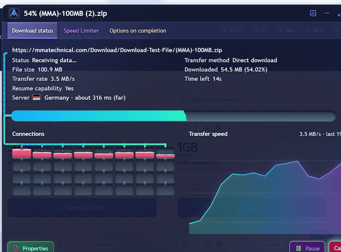

# Auralis Download Manager

[English](README.md) · [العربية](README.ar.md) · [Español](README.es.md) · [Français](README.fr.md) · [Deutsch](README.de.md) · [Português](README.pt-BR.md) · [简体中文](README.zh-CN.md)

أوراليس مدير تنزيل مجاني لنظام Windows x64 بواجهة مستوحاة من الزجاج وأدوات تفصيلية للتحكم بالتنزيل وإضافة للمتصفح. وهو تفرّع مستقل مفتوح المصدر بترخيص GPL-3.0 من [Mister Download Manager](https://github.com/anefzaoui/misterdownloadmanager)، وليس إصدارًا رسميًا منه.

[تنزيل أحدث إصدار لنظام Windows](https://github.com/4ls4mi/Auralis-Download-Manager/releases/latest) · [حزم إضافة المتصفح](https://github.com/4ls4mi/Auralis-Download-Manager/releases/latest) · [ملاحظات الإصدارات](CHANGELOG.md)

## أوراليس أثناء العمل

## المزايا

- تنزيل متعدد الاتصالات مع الإيقاف والاستئناف وقوائم الانتظار والتحكم في السرعة ومخطط مباشر للنقل.
- إضافة متصفح مخصصة لإرسال التنزيلات وروابط الوسائط المدعومة إلى أوراليس. تتوفر حزم Chromium وFirefox ضمن ملفات الإصدار، وقد يلزم تثبيت الإضافة والموافقة على الأذونات.
- نوافذ منفصلة للتنزيل ومعلومات الملف والاكتمال والإعدادات، مع خامات وألوان ومؤشرات قابلة للتخصيص بشكل مستقل.
- أدوات في منطقة الإعلام، وخيار بدء التشغيل مع Windows، وأيقونة منفصلة لنوافذ التنزيل المخفية.
- عرض جودات الفيديو والصوت باستخدام yt-dlp، مع جلسة المتصفح أو ملف ملفات تعريف ارتباط تختاره عند دعم الموقع.
- إشعارات وتحديثات داخل التطبيق، ونسخ احتياطي للتفضيلات واستعادتها.
- يعمل محرك التنزيل داخل أوراليس؛ ويستخدم مساعد صغير للرسائل الأصلية عند اتصال المتصفح بالتطبيق.
- أضف رابط HTTP أو HTTPS أو FTP، أو أرسله من المتصفح؛ تعرض نافذة التنزيل السرعة والاتصالات والوقت المتبقي. يُستأنف التنزيل عندما يدعم المصدر ذلك، وقد يستغرق تفريغ القرص أو التحقق وقتًا بعد اكتماله.
- يُستخدم المجموع الاختباري الكامل الذي يقدمه الخادم للتحقق عند دعمه. يمكن إضافة ملف تورنت أو رابط مغناطيسي ومراجعة الملفات والوجهة وإعادة فحص الأجزاء ببصمات التورنت. قد يحتاج دمج الفيديو والصوت إلى FFmpeg.
- يتضمن تصدير السمة اللوحة والخامة والخط وخيارات المؤشرات، لكنه لا يضم ملفات خلفية الشاشة. راجع [صيغة السمات](docs/auralis-theme-format.md).

لا تشمل نسخة التفضيلات الاحتياطية كلمات المرور أو بيانات الحسابات أو ملفات تعريف ارتباط المتصفح؛ قد تحتاج إلى تسجيل الدخول مجددًا عند الانتقال إلى تثبيت جديد. وقد تؤثر قيود المتصفح والموقع في البحث عن الفيديو.

## الأدلة والاستعادة

تتوفر [أدلة الاستخدام](docs/auralis-guide-drafts/ar.md) بالعربية والإنجليزية ولغات أخرى، وما زالت تُحدَّث مع التطبيق.

تُكتب بيانات التنزيلات العادية المقسّمة مباشرة في مواضعها داخل ملف مؤقت واحد. يفحص التحقق المحلي الكتل التي سُجّلت لها بصمات؛ ويعتمد الإصلاح على خادم متوافق ولا يمكنه فرض دعم نطاقات البايت. يمكن فحص تورنت أو رابط مغناطيسي أو البحث في Internet Archive لاستعادة تنزيل مباشر متوقف. تطابق الأجزاء المحفوظة لا يثبت تطابق بقية الملف؛ تتطلب الاستعادة أقرانًا وتحافظ على الملف الجزئي الأصلي. الاستعادة التلقائية قيد التطوير.

يمكن تصدير سمة قابلة للتعديل بصيغة JSON واستيرادها، بما فيها خيارات المؤشرات. لا تشمل نسخة التفضيلات الاحتياطية الملفات المنزَّلة أو الملفات الجزئية أو سجل التنزيلات؛ ويجري تطوير النسخ الكامل.

## التثبيت

نزّل مُثبّت Windows x64 من [أحدث إصدار](https://github.com/4ls4mi/Auralis-Download-Manager/releases/latest) وشغّله. لربط متصفح، ثبّت إضافة أوراليس المناسبة من ملفات الإصدار واتبع تعليمات **الإعدادات ← تكامل المتصفح**.

## الترخيص ونَسب العمل

يُوزَّع أوراليس وفق [رخصة GNU GPL v3](LICENSE). وهو تفرّع من Mister Download Manager لأحمد نفزاوي والمساهمين؛ راجع [نَسب العمل](ATTRIBUTION.md) و[المشروع الأصلي](https://github.com/anefzaoui/misterdownloadmanager).
