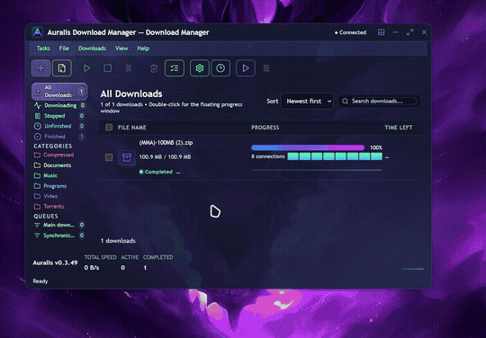
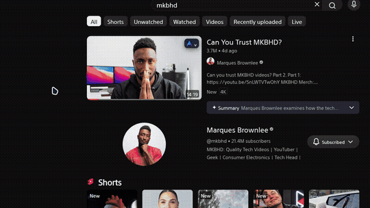
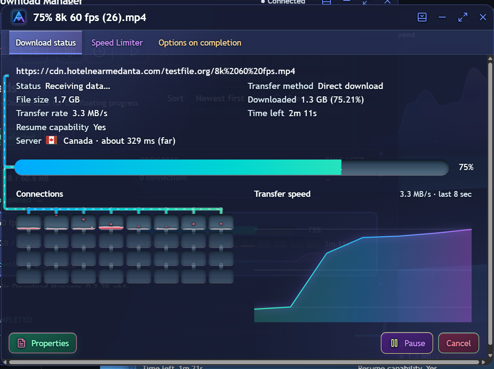
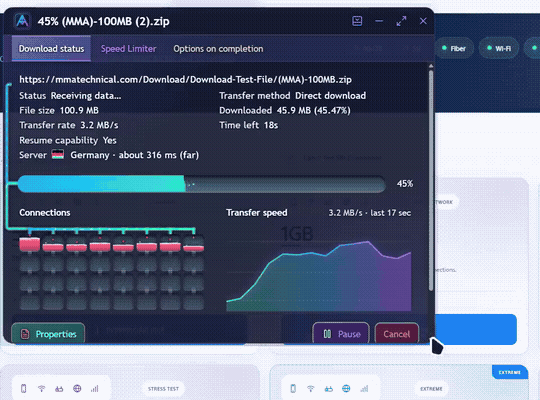
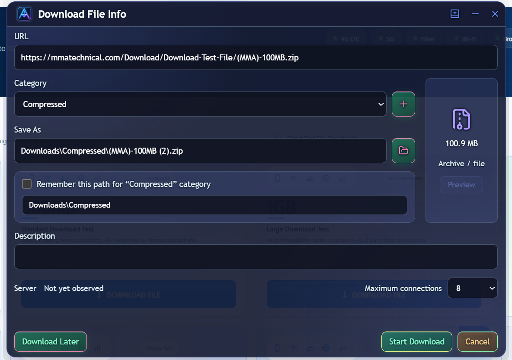
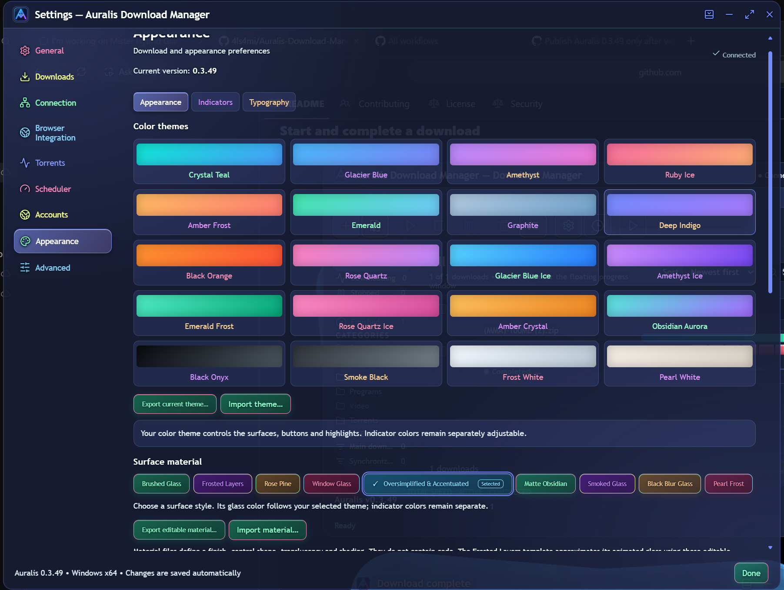

# Auralis Download Manager

[English](README.md) · [العربية](README.ar.md) · [Español](README.es.md) · [Français](README.fr.md) · [Deutsch](README.de.md) · [Português](README.pt-BR.md) · [简体中文](README.zh-CN.md)

Auralis ist ein kostenloser Download-Manager für Windows x64 mit glasähnlicher Oberfläche, detaillierter Steuerung und Browser-Erweiterung. Es ist ein unabhängiger GPL-3.0-Fork von [Mister Download Manager](https://github.com/anefzaoui/misterdownloadmanager), keine offizielle Version.

[Aktuelle Windows-Version herunterladen](https://github.com/4ls4mi/Auralis-Download-Manager/releases/latest) · [Browser-Erweiterungen](https://github.com/4ls4mi/Auralis-Download-Manager/releases/latest) · [Versionshinweise](CHANGELOG.md)

## Screenshots

### Downloadmanager

### Vorführung des Downloadmanagers

### Vorführung der Browser-Erweiterung

### Laufender Download

### Dateiinformationen

### Download abgeschlossen

### Darstellungseinstellungen

## Funktionen

- Downloads mit mehreren Verbindungen, Pause und Fortsetzung, Warteschlangen, Geschwindigkeitsbegrenzung und Live-Diagramm.
- Browser-Erweiterung für unterstützte Downloads und Medienlinks. Chromium- und Firefox-Pakete liegen bei den Release-Dateien; Installation und Berechtigungen sind erforderlich.
- Eigene Fenster für Download, Dateiinformation, Abschluss und Einstellungen mit unabhängig anpassbaren Materialien, Farben und Anzeigen.
- Infobereich-Steuerung, optionaler Windows-Start und separates Symbol für ausgeblendete Downloadfenster.
- Video- und Audioqualitäten über yt-dlp ermitteln; Browser-Sitzung oder Cookie-Datei verwenden, soweit die Website es unterstützt.
- Benachrichtigungen und Updates in der App sowie Sicherung und Wiederherstellung von Einstellungen.
- Die Download-Engine läuft in Auralis; ein kleiner nativer Helfer verbindet den Browser mit der App.
- HTTP-, HTTPS- oder FTP-Links hinzufügen oder aus dem Browser senden; das Downloadfenster zeigt Geschwindigkeit, Verbindungen und Restzeit. Die Fortsetzung hängt von der Quelle ab; Festplattenschreiben und Prüfung können Zeit benötigen.
- Unterstützte Prüfsummen vom Server können verwendet werden. Torrent oder Magnet hinzufügen, Dateien und Ziel prüfen und Teile anhand ihrer Hashes erneut prüfen. Manche Audio-/Videozusammenführungen benötigen FFmpeg.
- Der Theme-Export enthält Palette, Material, Schrift und Anzeigen, aber keine Hintergrunddateien. Siehe [Theme-Format](docs/auralis-theme-format.md).

Die Einstellungssicherung enthält keine Passwörter, Zugangsdaten oder Browser-Cookies; eine erneute Anmeldung kann nötig sein. Browser- und Website-Einschränkungen können die Videosuche beeinflussen.

## Anleitungen und Wiederherstellung

Die [Anleitungen](docs/auralis-guide-drafts/de.md) stehen in mehreren Sprachen zur Verfügung und werden aktualisiert.

Gewöhnliche segmentierte Downloads schreiben Daten direkt an die richtige Stelle in einer temporären Datei. Eine Prüfung erkennt Änderungen an Blöcken mit gespeicherten Hashes; Reparaturen benötigen einen geeigneten Server und können Range-Unterstützung nicht erzwingen. Für einen angehaltenen Download lassen sich Torrent oder Magnet vergleichen oder Internet Archive durchsuchen. Übereinstimmende Teile beweisen den Rest nicht; Peers sind nötig und die ursprüngliche Teildatei bleibt erhalten. Automatische Wiederherstellung ist in Entwicklung.

Editierbare JSON-Themes einschließlich der Anzeigen können exportiert und importiert werden. Die Einstellungssicherung enthält noch keine Downloads, Teildateien oder Historie; eine vollständige Sicherung wird entwickelt.

## Installation

Das Windows-x64-Setup aus der [aktuellen Version](https://github.com/4ls4mi/Auralis-Download-Manager/releases/latest) herunterladen und starten. Die passende Erweiterung installieren und **Einstellungen → Browser-Integration** folgen.

## Lizenz und Quellen

Auralis wird unter [GNU GPL v3](LICENSE) verteilt und basiert auf Mister Download Manager von Ahmed Nefzaoui und Mitwirkenden; siehe [Namensnennung](ATTRIBUTION.md) und [Originalprojekt](https://github.com/anefzaoui/misterdownloadmanager).
