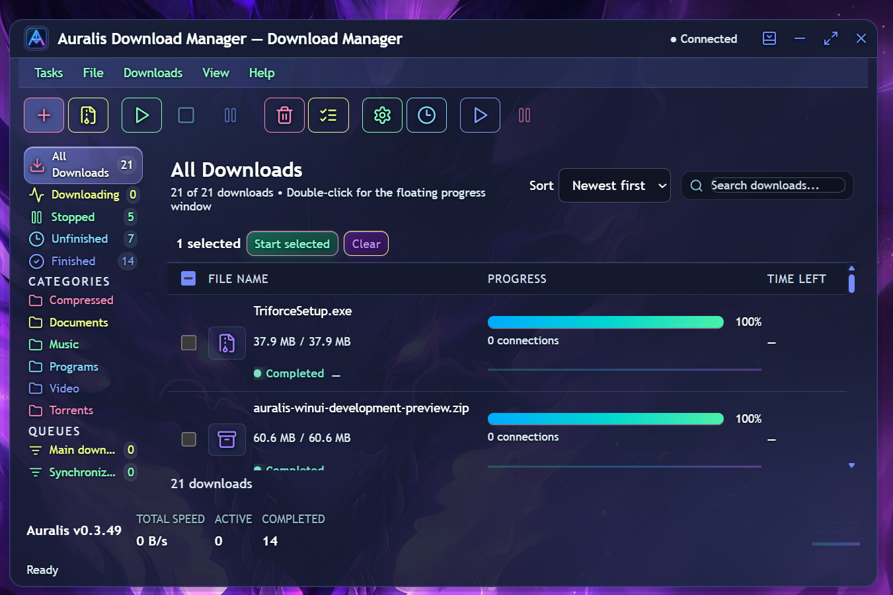

# Auralis Download Manager

[English](README.md) · [العربية](README.ar.md) · [Español](README.es.md) · [Français](README.fr.md) · [Deutsch](README.de.md) · [Português](README.pt-BR.md) · [简体中文](README.zh-CN.md)

Auralis est un gestionnaire de téléchargement gratuit pour Windows x64, doté d’une interface inspirée du verre, de commandes détaillées et d’une extension de navigateur. Il s’agit d’un fork indépendant GPL-3.0 de [Mister Download Manager](https://github.com/anefzaoui/misterdownloadmanager), et non d’une version officielle.

[Télécharger la dernière version Windows](https://github.com/4ls4mi/Auralis-Download-Manager/releases/latest) · [Extensions de navigateur](https://github.com/4ls4mi/Auralis-Download-Manager/releases/latest) · [Notes de version](CHANGELOG.md)

## Captures

### Gestionnaire de téléchargements

### Démonstration du gestionnaire de téléchargements

### Démonstration de l’extension de navigateur

### Téléchargement en cours

### Informations du fichier

### Téléchargement terminé

### Paramètres d’apparence

## Fonctionnalités

- Téléchargements multiconnexions avec pause, reprise, files, limites de débit et graphique en direct.
- Extension pour envoyer les téléchargements et liens multimédias pris en charge. Les paquets Chromium et Firefox figurent dans les fichiers de version ; installation et autorisations sont nécessaires.
- Fenêtres distinctes de téléchargement, informations, fin et réglages, avec matériaux, couleurs et indicateurs configurables.
- Commandes dans la zone de notification, démarrage facultatif avec Windows et icône distincte pour les téléchargements masqués.
- Recherche des qualités vidéo et audio avec yt-dlp, à partir de la session du navigateur ou d’un fichier de cookies lorsque le site le permet.
- Notifications et mises à jour intégrées, sauvegarde et restauration des préférences.
- Le moteur fonctionne dans Auralis ; un petit assistant natif relie le navigateur à l’application.
- Ajoutez un lien HTTP, HTTPS ou FTP ou envoyez-le depuis le navigateur ; la fenêtre affiche débit, connexions et temps restant. La reprise dépend de la source, et la synchronisation disque ou la vérification peut prendre du temps.
- Les sommes complètes fournies par le serveur peuvent être utilisées. Ajoutez un torrent ou magnet, vérifiez les fichiers et la destination, puis contrôlez les pièces avec leurs empreintes. Certains assemblages audio/vidéo nécessitent FFmpeg.
- L’export du thème comprend palette, matériau, typographie et indicateurs, mais pas les fichiers de fond d’écran. Voir le [format des thèmes](docs/auralis-theme-format.md).

La sauvegarde des préférences exclut mots de passe, identifiants et cookies ; une reconnexion peut être nécessaire. Les restrictions des sites et navigateurs peuvent affecter la recherche vidéo.

## Guides et récupération

Consultez les [guides](docs/auralis-guide-drafts/fr.md), proposés en plusieurs langues et en cours de mise à jour.

Les téléchargements segmentés ordinaires écrivent les octets à leur position dans un seul fichier temporaire. La vérification détecte les changements des blocs dont les empreintes sont enregistrées ; la réparation dépend d’un serveur compatible et ne peut pas imposer la prise en charge des plages. Un torrent ou magnet peut être comparé, ou recherché sur Internet Archive, pour reprendre un téléchargement arrêté. Les pièces correspondantes ne prouvent pas le reste ; des pairs sont nécessaires et le fichier partiel original est conservé. La récupération automatique est en développement.

Exportez et importez un thème JSON modifiable avec les indicateurs. La sauvegarde des préférences ne comprend pas encore les fichiers téléchargés, partiels ou l’historique ; une sauvegarde complète est en développement.

## Installation

Téléchargez et lancez l’installateur Windows x64 depuis la [dernière version](https://github.com/4ls4mi/Auralis-Download-Manager/releases/latest). Installez l’extension appropriée et suivez **Paramètres → Intégration du navigateur**.

## Licence et attribution

Auralis est distribué sous [GNU GPL v3](LICENSE). Il dérive de Mister Download Manager par Ahmed Nefzaoui et les contributeurs ; voir [attribution](ATTRIBUTION.md) et le [projet d’origine](https://github.com/anefzaoui/misterdownloadmanager).
