# Auralis Download Manager

[العربية](https://github.com/4ls4mi/Auralis-Download-Manager/blob/main/README.ar.md) · [Español](https://github.com/4ls4mi/Auralis-Download-Manager/blob/main/README.es.md) · [Français](https://github.com/4ls4mi/Auralis-Download-Manager/blob/main/README.fr.md) · [Deutsch](https://github.com/4ls4mi/Auralis-Download-Manager/blob/main/README.de.md) · [Português](https://github.com/4ls4mi/Auralis-Download-Manager/blob/main/README.pt-BR.md) · [简体中文](https://github.com/4ls4mi/Auralis-Download-Manager/blob/main/README.zh-CN.md)

Auralis is a free, open-source download manager with customizable glass materials, tools to check and repair interrupted downloads, and a right-to-left Arabic interface with selectable fonts. It is a GPL-3.0 fork of Mister Download Manager. [Upstream project](https://github.com/anefzaoui/misterdownloadmanager)

[**Download for Windows x64**](https://github.com/4ls4mi/Auralis-Download-Manager/releases/latest#assets) · [Debian 13 and macOS installers](https://github.com/4ls4mi/Auralis-Download-Manager/releases/latest#assets) · [Release notes](https://github.com/4ls4mi/Auralis-Download-Manager/releases)

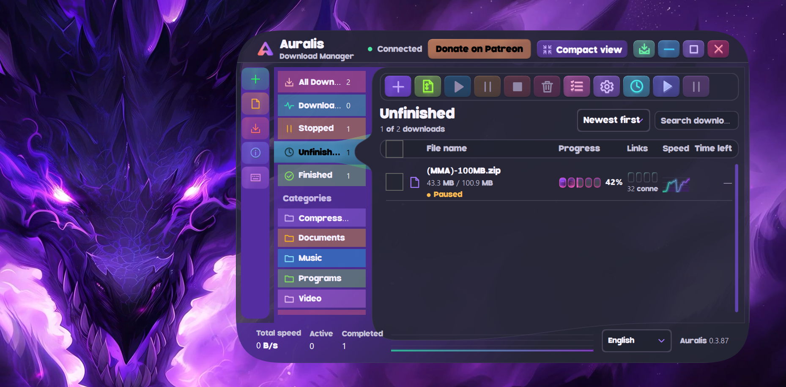

## What Auralis adds

Auralis and Mister Download Manager both offer multi-connection downloads, pause and resume, browser capture, queues, scheduling, speed limits, and torrents. The differences below are based on the documented features in MDM v0.5.2. [MDM v0.5.2 documentation](https://github.com/anefzaoui/misterdownloadmanager/tree/v0.5.2/docs)

| Feature | Auralis | Mister Download Manager v0.5.2 |
| --- | --- | --- |
| Interface and themes | Glass and solid materials, a compact view, separate image or video backgrounds for the main and detail windows, and editable JSON theme import and export. | Desktop-style themes, dark mode, scaling, and editable theme files. |
| Transfer indicators | Choose independent materials and colors for progress bars, connections, and speed graphs. Progress layouts include Pill Segments and other shapes. | Download progress and connection activity with theme-level progress shape and color controls. |
| Saved-data check and repair | Verify downloaded blocks against recorded hashes and re-download changed ranges from a compatible HTTP source. | Resume and refresh download links, verify a file against a known checksum, and recheck torrent pieces. |
| Direct-to-torrent recovery | Find an Internet Archive candidate or compare a torrent or magnet for an interrupted direct download. Reuse verified pieces and keep the original partial. | Reuse existing bytes when starting a torrent against matching files. |
| Download backup | Export preferences, history, queues, completed files, and supported partials in an archive you can restore to a new destination. A settings-only JSON is also available. | Portable profile folder and link-list import and export. |
| Arabic typography and scaling | Arabic right-to-left layout, separate English and Arabic font pickers with live previews, and independent text and interface scaling. The Windows installer bundles fonts for both. | Arabic RTL and broad language support, with theme-level font sizing. |

Saved-data checks cover blocks with recorded hashes. HTTP repair needs a compatible source that supports byte ranges. Auralis can only reuse torrent pieces that verify, and recovery needs available peers. Automatic fallback is off by default. It can continue after direct retries fail if a single candidate passes verification and at least two saved pieces can be reused. Internet Archive searches send filename terms to the service.

## Explore the app

Starting in v0.3.88, a fresh profile opens with **Violet Rail Wide Sweep** and a **Grape Taffy** progress bar in **Pill Segments**. Open **Settings → Appearance** to adjust colors, opacity, and motion, or export your choices to a theme file. [Theme file format](docs/auralis-theme-format.md)

- **Set up in your language.** Choose a language on first launch and switch it from the main window. The setup wizard has separate pages for browser integration and video or gallery helpers. Browser connection is available on Windows.
- **Check your destination.** The add-download window displays the drive’s total and free space. Use **Refresh download address** to replace an expired link when the host supports resuming it.
- **Choose what to save.** Use the extension and optional yt-dlp and FFmpeg helpers for supported video or audio sources. For torrents, select the files you want and monitor peer activity.
- **Keep an eye on transfers.** Open a download for live connections and speed history, or use compact view and tray controls. On Windows, the updater can be hidden while progress remains visible in the main window.
- **Move to another installation.** Stop transfers, checks, and queues before creating a download backup. Backups exclude passwords and browser cookies.

## Screenshots and demos

Captured on Windows. Expand a demo to see the controls in motion.

### Appearance

| Surface materials | Progress styling |
| --- | --- |
| 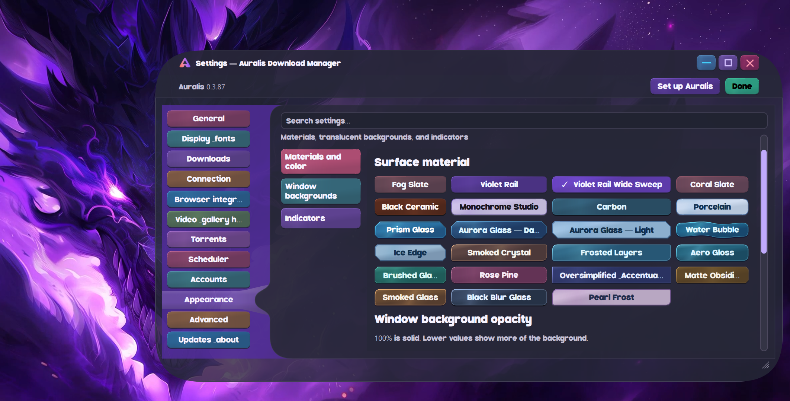 | 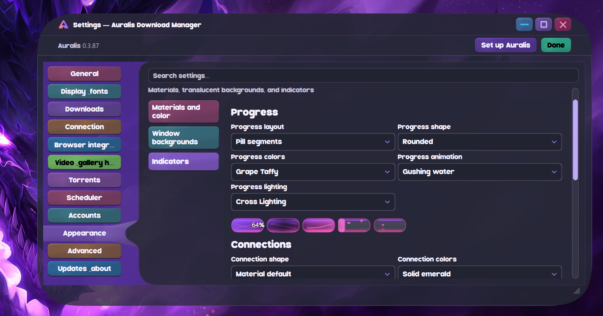 |

Watch filters, compact view, and appearance changes

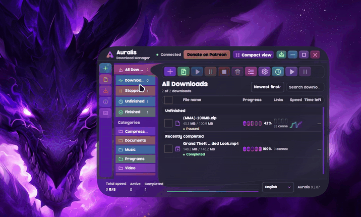

### Transfers and recovery

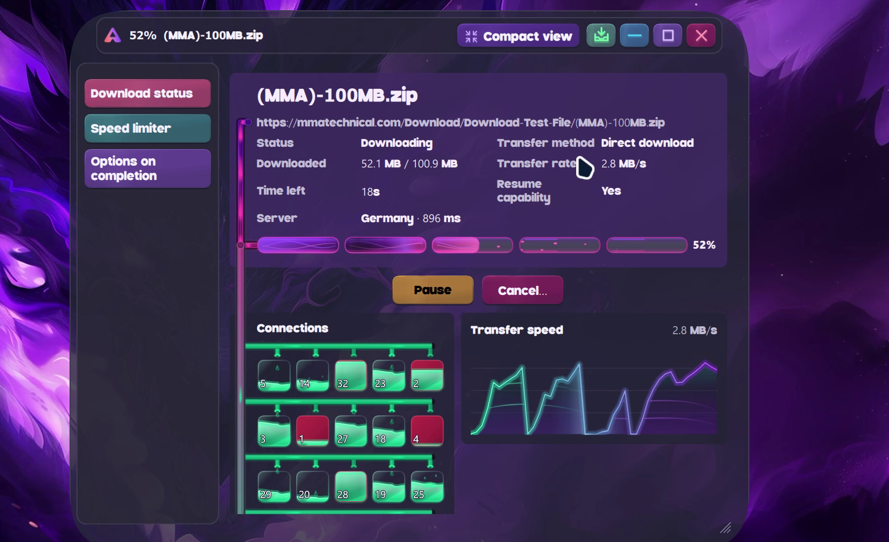

| Recovery options | Completed download |
| --- | --- |
| 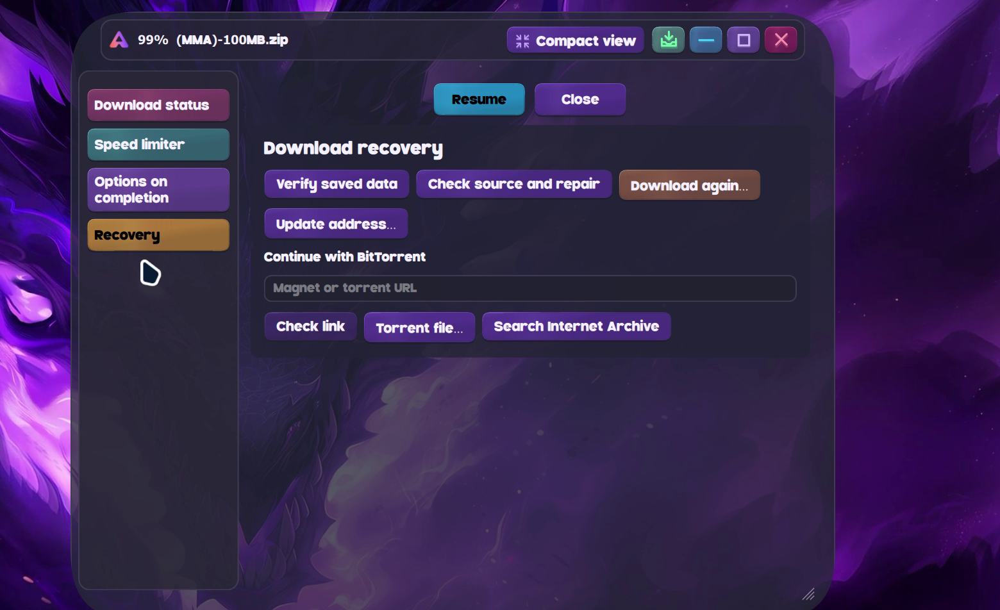 | 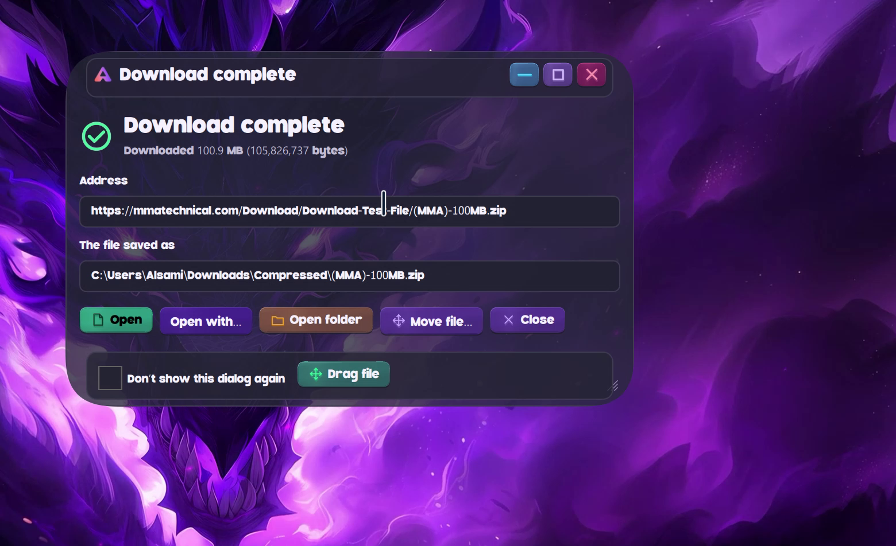 |

Watch a transfer, its recovery controls, and completion

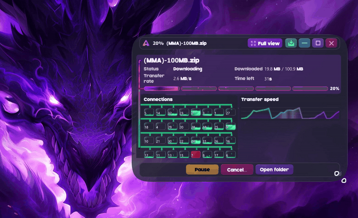

### Browser video download

#### From a video thumbnail

Hover over a YouTube thumbnail and click the **Auralis** button on the thumbnail to open the quality menu. Select **Fetch qualities** to run the lookup again. [Screenshot](docs/images/auralis/windows-gallery/extension-thumbnail-qualities.png)

#### From the playing video

Click the **Auralis** button at the top right of the video player to open the format menu. Select **Fetch qualities** to run the lookup again. [Screenshot](docs/images/auralis/windows-gallery/extension-player-qualities.png)

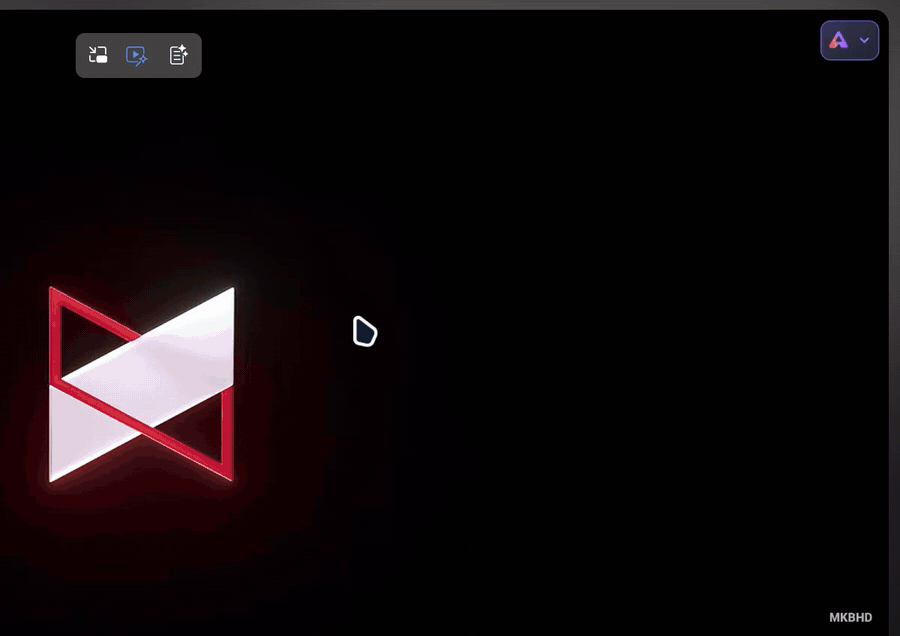

The demos show the notice Auralis displays when YouTube format lookup needs a JavaScript runtime.

#### Video confirmation and progress

| Confirm video download | Compact transfer |
| --- | --- |
| 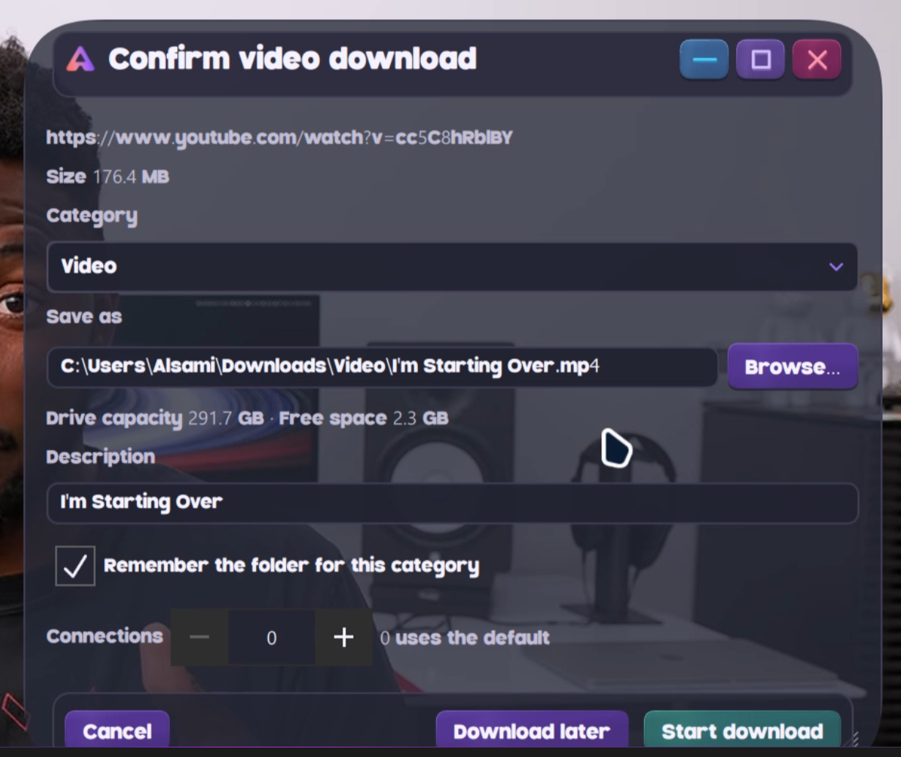 | 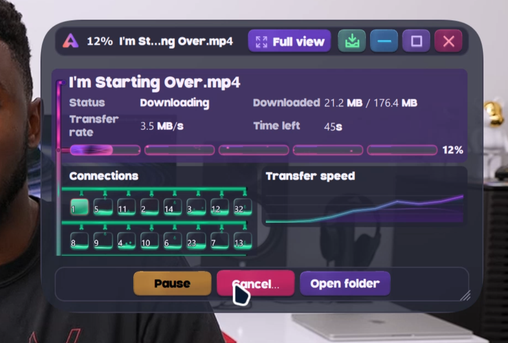 |

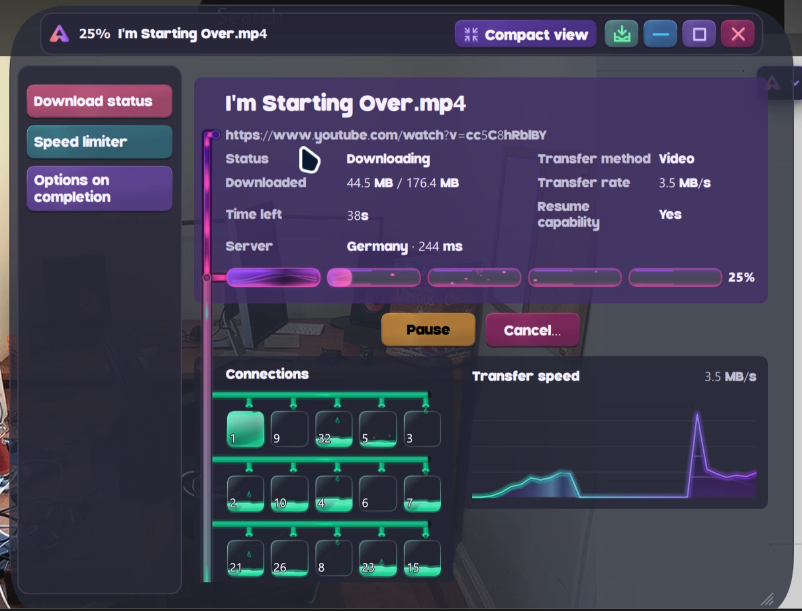

Watch the compact video transfer

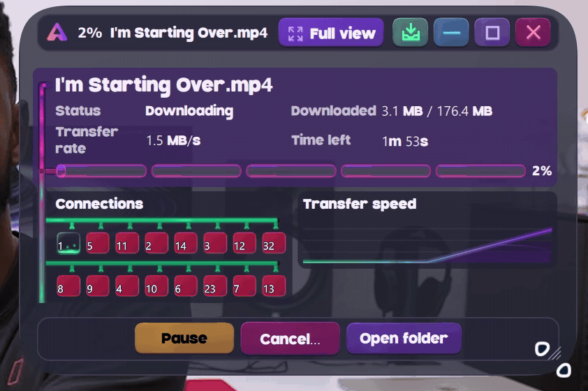

More stills from the Windows recordings

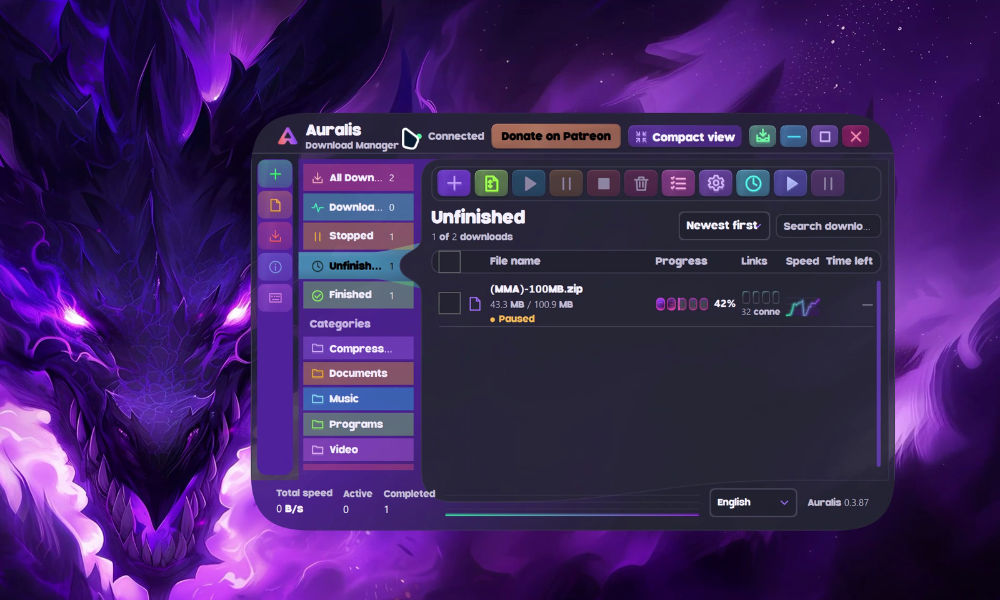

| Materials menu | Progress indicators |
| --- | --- |
| 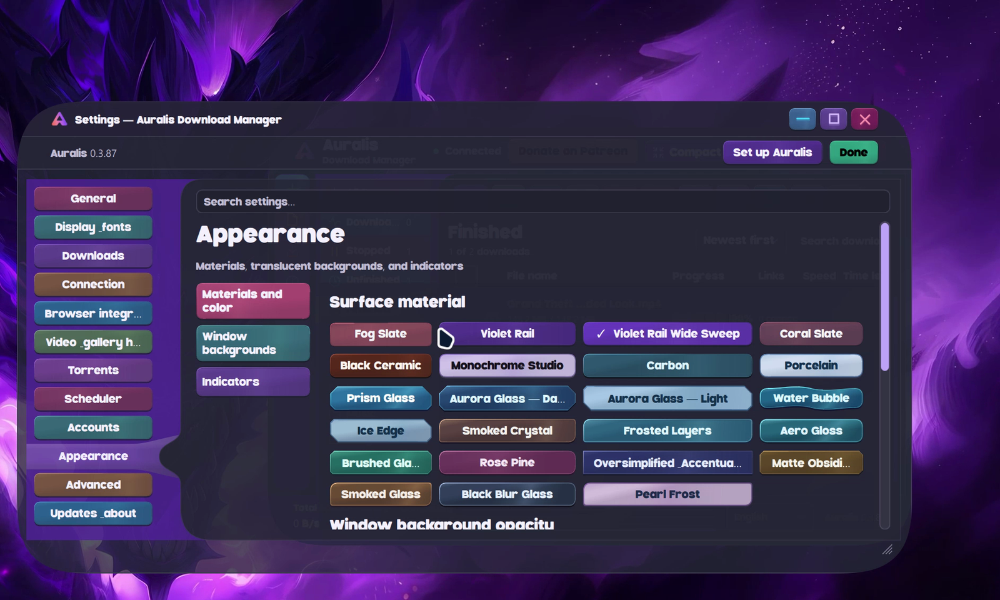 | 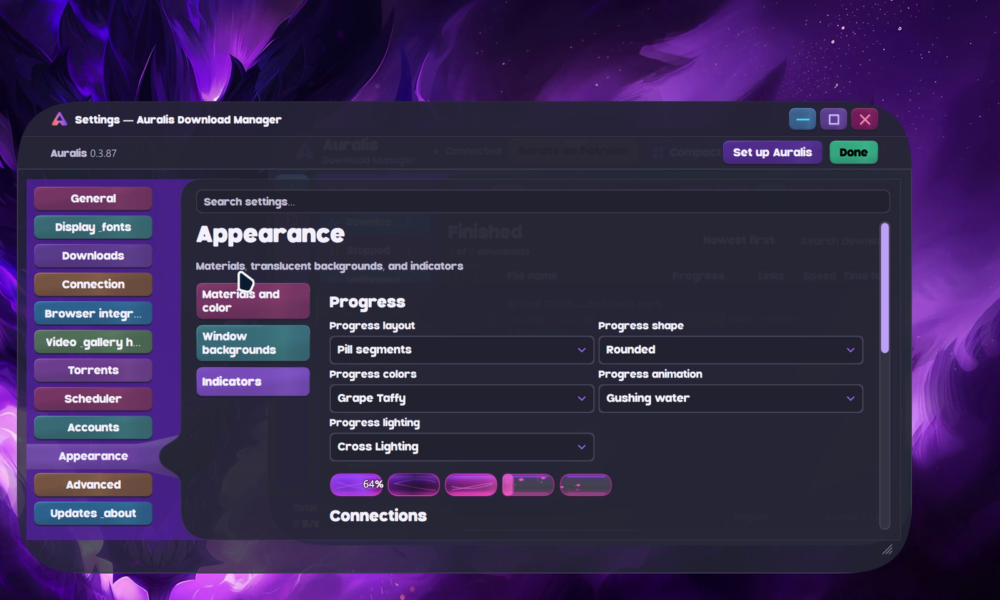 |

| Download confirmation | Live compact video transfer |
| --- | --- |
| 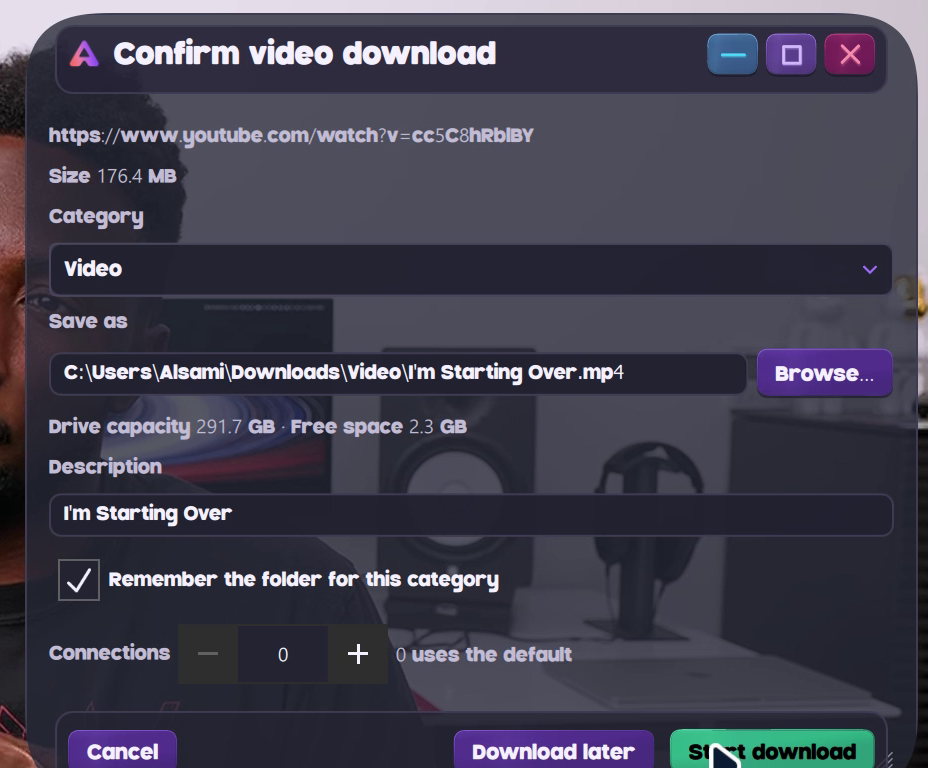 | 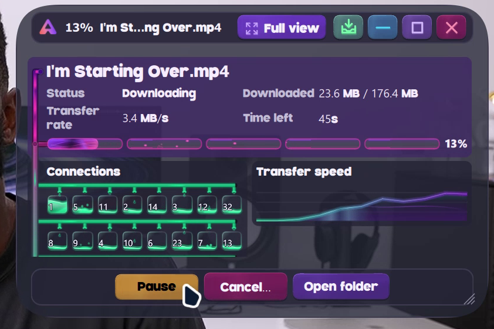 |

## Install and connect a browser

1. Open the latest release and choose the Windows x64 installer, Debian 13 amd64 package, or Intel macOS disk image. GitHub lists SHA-256 digests for the release assets. [Desktop downloads](https://github.com/4ls4mi/Auralis-Download-Manager/releases/latest#assets)
2. On Windows, follow the setup wizard or open **Settings → Browser integration**. Install the Auralis extension from the Chrome Web Store in Chrome or Edge and follow the browser’s prompts. The release includes ZIPs for unpacked Chromium installation and temporary Firefox testing. [Auralis Chrome Web Store listing](https://chromewebstore.google.com/detail/auralis-download-manager/bobmhloppnfipdjjncalidjenegfgebg)
3. Select **Add URL** or send a supported download from a connected browser. Double-click the item to view its progress, connections, and speed graph.

## Guides and feedback

[English](docs/auralis-guide-drafts/en.md) · [العربية](docs/auralis-guide-drafts/ar.md) · [Español](docs/auralis-guide-drafts/es.md) · [Français](docs/auralis-guide-drafts/fr.md) · [Deutsch](docs/auralis-guide-drafts/de.md) · [Português](docs/auralis-guide-drafts/pt-BR.md) · [简体中文](docs/auralis-guide-drafts/zh-CN.md)

For a bug report, include the Auralis version, operating system, and steps to reproduce it. [Report an issue](https://github.com/4ls4mi/Auralis-Download-Manager/issues/new)

Planned distribution improvements include a bilingual download page, Windows package-manager listings, and an evaluation of installer signing. The latest stable packages are available on GitHub Releases. [All releases](https://github.com/4ls4mi/Auralis-Download-Manager/releases)

## Support and attribution

Patreon support is optional and helps me build more apps and tools and localize games into Arabic.

Auralis is distributed under the GNU GPL v3 and builds on Mister Download Manager by Ahmed Nefzaoui and contributors. [License](LICENSE) · [Attribution](ATTRIBUTION.md) · [Upstream project](https://github.com/anefzaoui/misterdownloadmanager)
