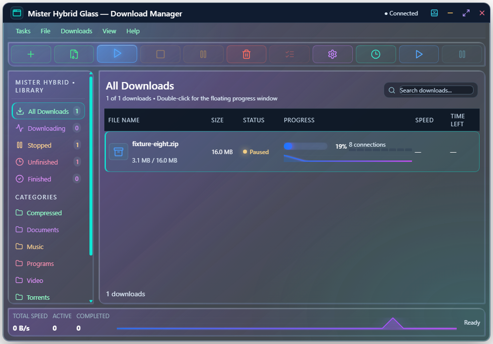
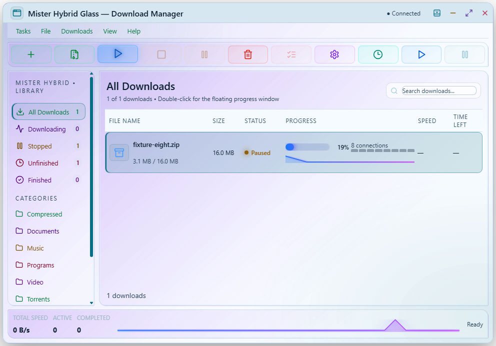
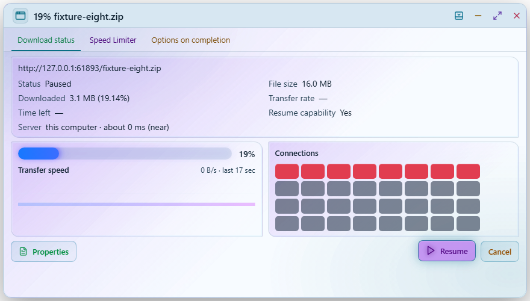
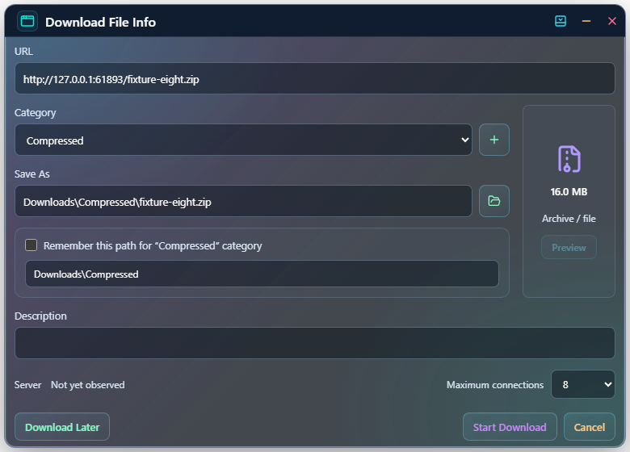
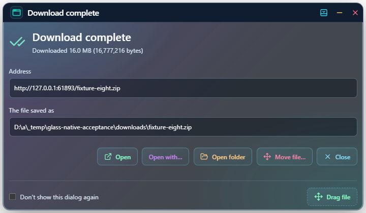
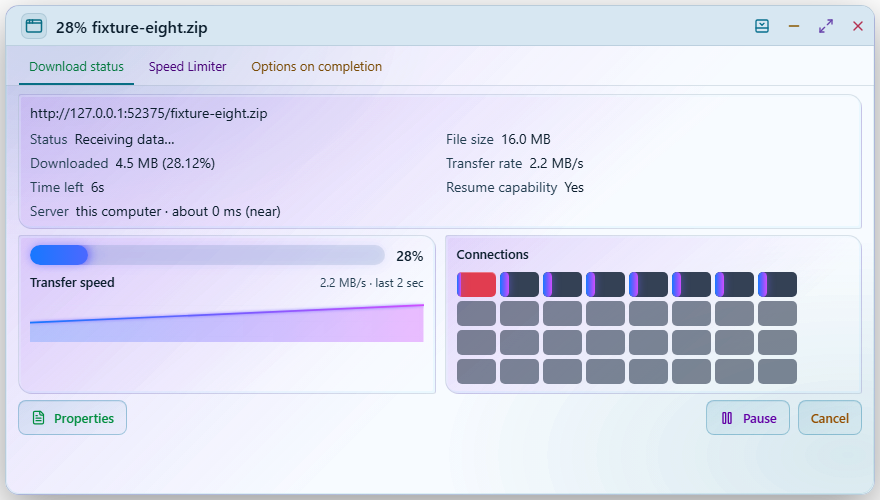

# Auralis Download Manager

**A Windows x64 download manager with a customizable glass-style interface, built on the original Mister Download Manager engine.**

[Download for Windows x64](https://github.com/4ls4mi/misterdownloadmanager/releases/latest) · [Release notes](https://github.com/4ls4mi/misterdownloadmanager/releases) · [Fork changelog](CHANGELOG.md#mister-hybrid-glass--windows-x64-preview) · [Original Mister Download Manager](https://github.com/anefzaoui/misterdownloadmanager)

Auralis Download Manager (previously Mister Hybrid Glass) is an independent, experimental fork of [Mister Download Manager](https://github.com/anefzaoui/misterdownloadmanager), created by Ahmed Nefzaoui and contributors. It combines MDM's downloader and browser integration with a separate Tauri/WebView2 interface, movable windows, appearance controls and live transfer indicators. It is not an official MDM release.

> **Current release:** Windows x64 preview. The installer and automated Windows tests are available from [Releases](https://github.com/4ls4mi/misterdownloadmanager/releases/latest). Some features and visual effects still need manual Windows verification; see [Current limitations](#current-limitations).

## Screenshots

These are screenshots captured from the Windows acceptance run, not design mockups. The download shown in the progress example is paused: eight reported connections are red and the other 24 slots are grey.

| Dark main window | Light main window |
| --- | --- |
|  |  |

| Download progress | Download file information |
| --- | --- |
|  |  |

A real test of an interrupted connection: its red background remains visible behind the retained progress fill.

## What the fork changes

### Interface and appearance

- Replaces the original visible shell with a glass-style interface while retaining the original engine as a bundled headless companion.
- Adds light and dark modes; accent, transparency, material, wallpaper, font, text-size and interface-scaling controls.
- Uses separate movable windows for download information, progress, completion, properties, settings and confirmations. The list and navigation can scroll when needed.
- Adds colorful icons, window controls and hover feedback. Progress-bar, connection and graph colors can be configured separately from the interface theme, with an indicator preview in Settings.
- Reduces redundant visual overlays. Windows backdrop and material appearance can vary by computer; the current rendering does not yet reproduce all design concepts.

### Downloads and connection information

- Keeps independent indicators for overall percentage, engine-reported connection progress and transfer-speed history in the download interface.
- Shows **32 responsive connection slots** in the progress window. Reported paused connections appear red; unused slots remain grey. Hover over an occupied slot for details. Displayed information comes from engine telemetry rather than fabricated activity.
- Keeps the original download details such as address, status, file size, downloaded amount, transfer rate, time remaining, resume capability and observed server country/latency when available.
- Provides pause, resume, stop, redownload, search, movable delete confirmations, queues, scheduler and original engine operations through the Glass interface.
- Includes a completion window with file and folder actions. The completed-file move workflow updates the stored path when a move is detected.

### Browser, clipboard and media tools

- Adds a dedicated Auralis browser extension based on the original MDM integration, with browser-side video and audio quality selection, available subtitle choices and per-video cookie controls. The matching Auralis desktop application supplies the native messaging host.
- Offers clipboard modes for automatic capture, offering a copied URL, or pasting it when Add URL is opened.
- Exposes the original helper management for **yt-dlp**, **ffmpeg** and **gallery-dl**, plus video-quality and available subtitle selection.
- Supports a browser/profile for helper cookies and a user-selected Netscape-format `cookies.txt` file for video helpers. A cookie file contains your signed-in session; keep it private.
- Keeps the original MDM release check separate from fork updates. Version 0.3.1 adds a fork release checker, release notes, download and digest verification, followed by an option to restart and install.

## Install

1. Download the Windows x64 setup executable from [the latest release](https://github.com/4ls4mi/misterdownloadmanager/releases/latest).
2. Run the installer and open Auralis Download Manager. The release notes identify the Windows build and its validation results.
3. For browser capture, download the **Auralis browser extension** ZIP for your browser from [Auralis 0.3.3 releases](https://github.com/4ls4mi/Auralis-Download-Manager/releases/tag/v0.3.3), then extract it to a folder you will keep. These are development packages:
   - **Edge:** open `edge://extensions`, enable Developer mode, choose **Load unpacked**, and select the extracted `auralis-chromium` folder.
   - **Chrome and compatible Chromium browsers:** open `chrome://extensions`, enable Developer mode, choose **Load unpacked**, and select that folder. Other Chromium browsers have a similar extensions page.
   - **Firefox:** open `about:debugging`, choose **This Firefox → Load Temporary Add-on**, and select `manifest.json` inside the extracted `auralis-firefox` folder. Temporary add-ons must be loaded again after Firefox restarts; permanent installation requires signing.

The Auralis desktop application must be installed and running for the extension to connect. Safari requires a separately packaged and signed extension and is not included in these ZIPs.

The Glass installer is a Windows x64 preview. Windows WebView2 is required. See the release page for the installer checksum and exact build information.

## Current limitations

- This fork is built and tested for **Windows x64**. Upstream's other platforms and installers belong to the original MDM project.
- The approved material concepts are design goals; the current desktop backdrop and surfaces need further rendering work and visual comparison on real Windows hardware.
- The Auralis extension ZIPs are development packages; live-site, Edge and Firefox testing remains outstanding. Browser security can block helper access to cookies, especially with Edge or Chrome. A manual cookie file can help, but YouTube account challenges, VPNs and site changes may still prevent a lookup. Google account autodetection/direct connection is not implemented.
- Version 0.3.2 may need a one-time manual update to 0.3.3 because its updater expects the earlier repository and installer names. The newer updater verifies GitHub’s SHA-256 digest; future updates still need end-to-end verification.
- Automated Windows checks passed for the preview's engine, dialogs, transfers and appearance screenshots. Physical Windows review of native drag to Explorer/apps, DPI and transparency remains necessary. A successful installer build alone is not proof of complete feature parity.

## Credits and license

Original Mister Download Manager is developed by [Ahmed Nefzaoui and contributors](https://github.com/anefzaoui/misterdownloadmanager). This fork preserves the original project's [GPL-3.0 license](LICENSE) and [third-party attribution](ATTRIBUTION.md). For the original app, its documentation and its releases, visit the [upstream repository](https://github.com/anefzaoui/misterdownloadmanager).
