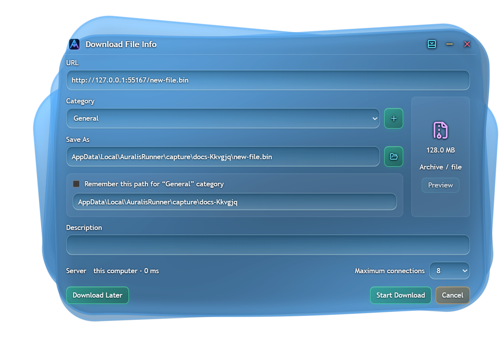

# Auralis Download Manager

Auralis is a free Windows x64 download manager with a glass-inspired interface, detailed transfer controls and its own browser extension. It is an independent GPL-3.0 fork of [Mister Download Manager](https://github.com/anefzaoui/misterdownloadmanager); it is not an official upstream release.

[Download Auralis for Windows](https://github.com/4ls4mi/Auralis-Download-Manager/releases/latest) · [Download the Auralis browser extension](https://github.com/4ls4mi/Auralis-Download-Manager/releases/latest) · [Release notes](CHANGELOG.md)

## Screenshots

These images show the Auralis interface with sample downloads. Appearance, indicator materials and colors are configurable.

| Download library | Current download |
| --- | --- |
|  |  |

| Appearance and indicator settings | Download details |
| --- | --- |
|  |  |

### Liquid indicators

Choose progress, connection and graph materials independently, then choose their colors and shapes. Liquid styles add animated flowing fills, droplets and waves; the underlying progress and connection states come from the downloader.

## Features

- Multi-connection downloads with pause and resume, queues, bandwidth controls and a live transfer graph.
- A dedicated browser extension for sending downloads and supported media links to Auralis. See the release assets for Chromium-based browsers and Firefox; browser-specific installation and permissions are required.
- Separate download, file information, completion and settings windows, with independently configurable materials, colors and indicator previews.
- System-tray controls, optional Windows startup, and a separate tray icon for hidden download windows.
- Video and audio quality lookup using yt-dlp, with browser-session and manual cookie options where supported.
- In-app release notifications and updates, plus preferences backup and restore.
- The downloader runs inside Auralis. A small native messaging helper is used when a browser communicates with the application.

Credentials and browser cookies are excluded from preferences backups; you may need to sign in again on a new Windows installation. Browser and site restrictions can still affect video lookup.

## Guides and recovery

Read the [English guide](docs/auralis-guide-drafts/en.md) or [Arabic guide](docs/auralis-guide-drafts/ar.md). Short guides are also available in [French](docs/auralis-guide-drafts/fr.md), [German](docs/auralis-guide-drafts/de.md), [Spanish](docs/auralis-guide-drafts/es.md), [Portuguese](docs/auralis-guide-drafts/pt-BR.md) and [Simplified Chinese](docs/auralis-guide-drafts/zh-CN.md). These guides are being updated alongside the app.

Ordinary segmented downloads write their received bytes directly into a single temporary file. Saved-data checking can detect changes in blocks that have recorded hashes; repair depends on a compatible server and cannot make a server support byte ranges. The upcoming Windows build adds automatic fallback for eligible direct downloads after direct retries are exhausted. In **Settings → Torrents**, choose whether Auralis should ask before using a match or continue automatically when there is one match, at least two saved pieces verify, and all candidate checks succeed. Automatic search uses Internet Archive. From **Find a torrent for recovery** in the download window, you can check a local torrent, magnet or public HTTP(S) torrent link. Auralis reuses only verified pieces, keeps the original partial and uses BitTorrent peers to fetch the rest. The download list marks recovered items **Direct → Torrent**.

Appearance settings can export and import an editable theme JSON with indicator choices.

In **Settings → General → Download backup**, use **Back up downloads…** to save preferences, history, queues, supported downloaded files and saved progress. Stop transfers, checks and queues first. Use **Restore downloads…** to select the archive and a destination for the files on the new installation. **Preferences backup** also offers a smaller settings-only JSON.

## Installation

Download the Windows x64 installer from the [latest release](https://github.com/4ls4mi/Auralis-Download-Manager/releases/latest) and run it. To connect a browser, install the matching Auralis extension from the release assets and follow the instructions in **Settings → Browser Integration**.

## License and attribution

Auralis is distributed under the [GNU GPL v3](LICENSE). It is a fork of Mister Download Manager by Ahmed Nefzaoui and contributors; see [ATTRIBUTION.md](ATTRIBUTION.md) and the [upstream project](https://github.com/anefzaoui/misterdownloadmanager).
