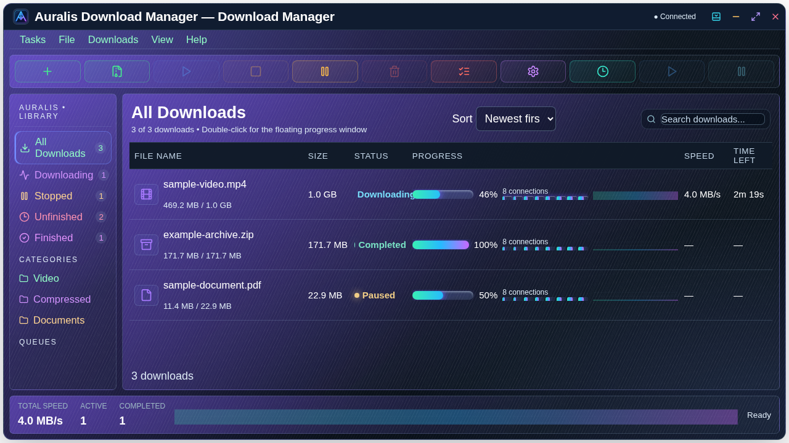
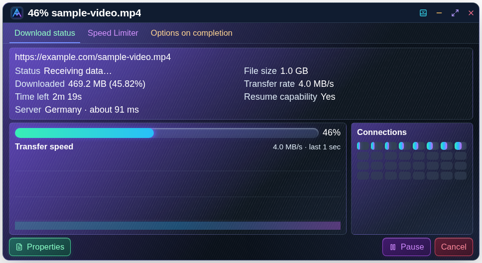
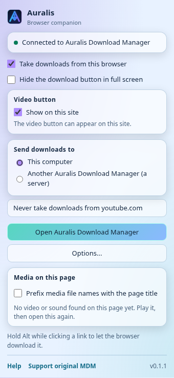

# Auralis Download Manager

**A modern Windows download manager with a customizable glass-style interface and its own browser extension.**

[Download for Windows](https://github.com/4ls4mi/Auralis-Download-Manager/releases/latest) · [All releases and changelogs](https://github.com/4ls4mi/Auralis-Download-Manager/releases) · [Fork changelog](CHANGELOG.md) · [Original Mister Download Manager](https://github.com/anefzaoui/misterdownloadmanager)

Auralis is an independent fork of [Mister Download Manager](https://github.com/anefzaoui/misterdownloadmanager), developed by Ahmed Nefzaoui and contributors. It retains the upstream download engine and adds its own Tauri/WebView2 interface, appearance controls, windows and browser companion. Auralis is not an official MDM release.

## See Auralis

These images show the actual interface rendered with **sample download data**. They are browser-rendered previews rather than Windows desktop captures; native transparency, backdrop effects and scaling can look different on a real system. The extension image shows the upcoming popup update; check the release notes for availability.

| Download library | Download progress |
| --- | --- |
|  |  |

Preview the Auralis extension popup

## What Auralis adds

- **Personal appearance:** dark and light modes, accent and glass tint controls, opacity, material choices, wallpaper, typography and scaling. Progress, connection and graph styles can be adjusted independently, with solid colors as well as gradients. Some materials are experimental and do not yet reproduce the reference designs.
- **Download information:** movable file-information, progress, completion and confirmation windows. The progress view shows the reported connection state, speed history, file size, remaining time and resume capability when available. Its 32 connection slots adapt to the window, and each occupied slot has details on hover.
- **Download management:** search and sorting, Ctrl/Shift multi-selection, bulk actions, optional deletion from disk, queues, scheduling and the upstream download engine's operations.
- **Independent Auralis extension:** a dedicated browser companion based on the original MDM integration. It sends downloads to Auralis and offers browser-side video, audio and subtitle choices and per-video cookie controls. Auralis includes a guided setup for its bundled extension.
- **Media helpers:** access to yt-dlp, ffmpeg and gallery-dl, a manual video-link helper and available subtitles. Cookie options include a browser session and manual cookies. The in-app YouTube sign-in option is experimental when present in the installed release.
- **Updates:** the app can check this fork's GitHub releases, show the changelog, download and verify the installer, and ask to restart. The upstream MDM release check is separate.

## Install Auralis and its extension

1. Download and run the **Auralis Download Manager Windows x64 setup** from [the latest release](https://github.com/4ls4mi/Auralis-Download-Manager/releases/latest). Windows WebView2 is required.
2. Open Auralis. If offered, follow the browser setup guide. You can also open **Settings → Browser Integration → Prepare extension and repair connection** to open the bundled extension folder and see the installation steps.
3. In Edge, open `edge://extensions`; in Chrome or a compatible Chromium browser, open `chrome://extensions`. Enable **Developer mode**, choose **Load unpacked**, and select the prepared Chromium folder. You can instead download the Chromium ZIP from the release page and extract it to a permanent folder.
4. In Firefox, open `about:debugging` → **This Firefox → Load Temporary Add-on**, then select `manifest.json` in the prepared Firefox folder. Firefox removes a temporary add-on when it closes; a permanent installation requires signing.
5. Reload the extension or browser after replacing an unpacked extension. Auralis must be running for it to connect. Safari needs separate packaging and signing and is not included in the release ZIPs.

## Current limitations

- Auralis releases target **Windows x64**. The original MDM project maintains its own platforms and releases.
- The extension packages are development builds. Browser integration, tray restoration, desktop transparency and scaling need continued real-Windows testing.
- Browser security can prevent direct cookie access. Manual cookies and extension-provided sessions may help, but Google or YouTube can still block embedded sign-in, request verification, or refuse a lookup. Keep cookie files private.
- The published Windows build and automated checks do not establish complete feature parity or exact visual matches to the material concepts. See each release's changelog for what has and has not been verified.
- Some older Mister Hybrid Glass installations may need a one-time manual upgrade to an Auralis installer because their updater expects the earlier installer name.

## Credits and license

Original Mister Download Manager is developed by [Ahmed Nefzaoui and contributors](https://github.com/anefzaoui/misterdownloadmanager). Auralis retains the original project's [GPL-3.0 license](LICENSE) and [third-party attribution](ATTRIBUTION.md).
