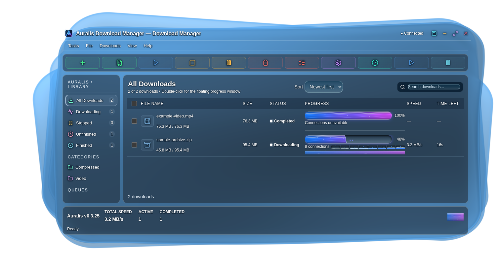
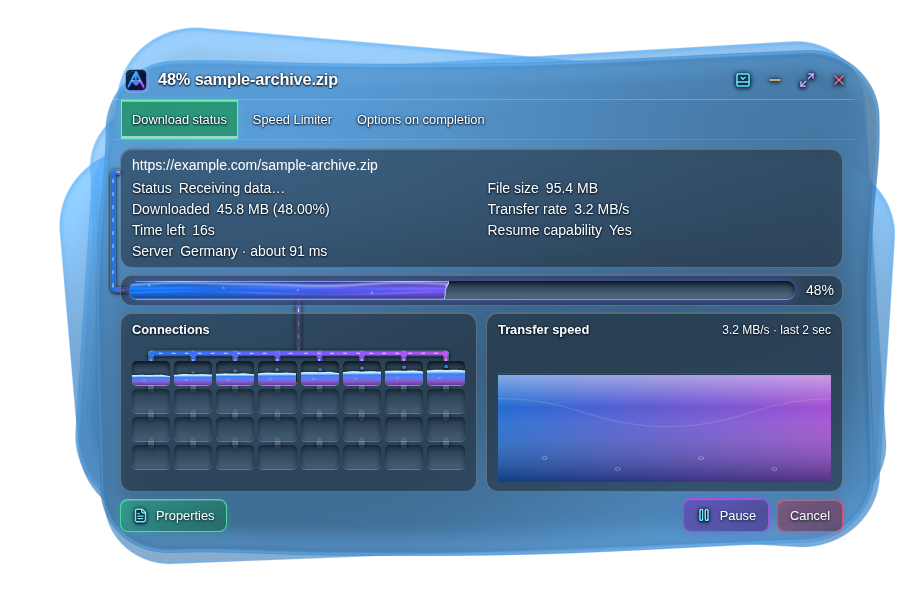
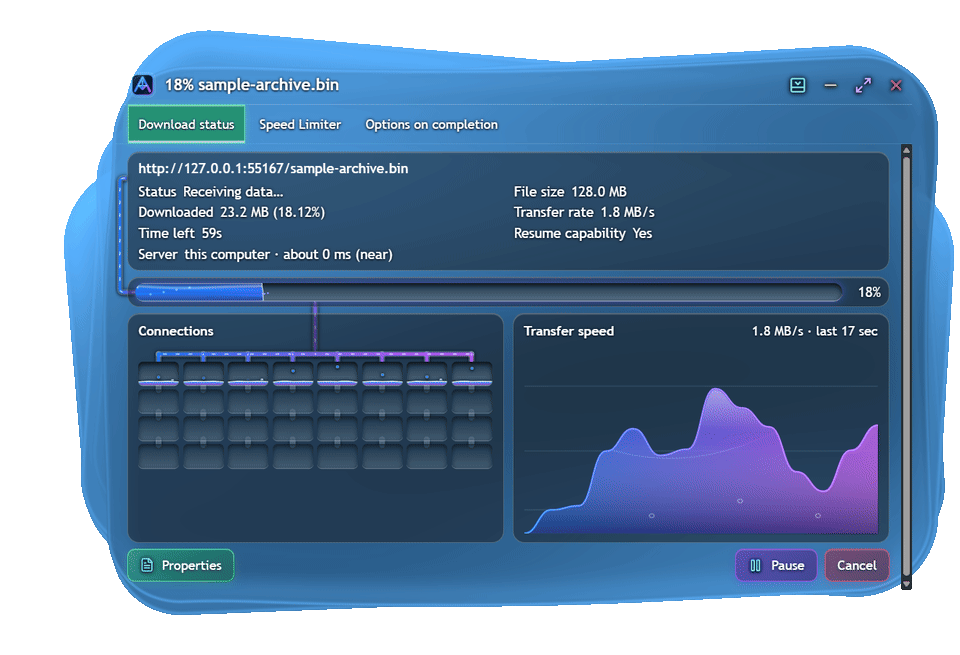
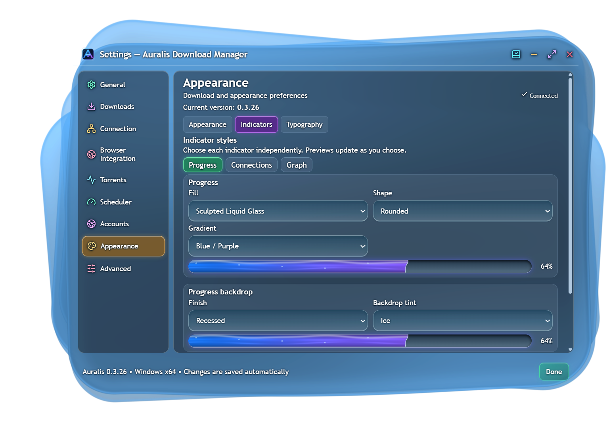
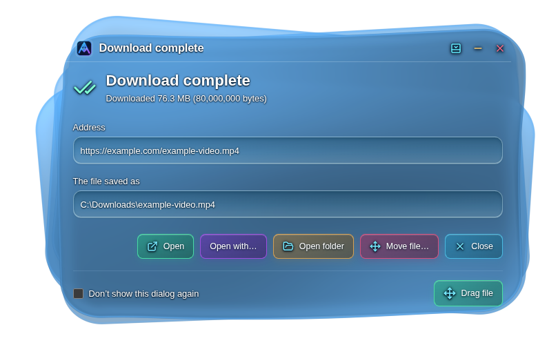

# Auralis Download Manager

Auralis is a free Windows x64 download manager with a glass-inspired interface, detailed transfer controls and its own browser extension. It is an independent GPL-3.0 fork of [Mister Download Manager](https://github.com/anefzaoui/misterdownloadmanager); it is not an official upstream release.

[Download Auralis for Windows](https://github.com/4ls4mi/Auralis-Download-Manager/releases/latest) · [Download the Auralis browser extension](https://github.com/4ls4mi/Auralis-Download-Manager/releases/latest) · [Release notes](https://github.com/4ls4mi/Auralis-Download-Manager/releases)

## Screenshots

These captures show Auralis 0.3.26 running on Windows with sample downloads. The transfer graph reflects measured speeds during a local sample transfer. The local save path in the completion screenshot has been redacted.

### Download manager

### Live transfer and liquid indicators

### Customize the appearance

### Start and complete a download

## Features

- Multi-connection downloads with pause and resume, queues, bandwidth controls and a live transfer graph.
- A dedicated browser extension for sending downloads and supported media links to Auralis. See the release assets for Chromium-based browsers and Firefox; browser-specific installation and permissions are required.
- Separate download, file information, completion and settings windows, with independently configurable materials, colors and indicator previews.
- System-tray controls, optional Windows startup, and a separate tray icon for hidden download windows.
- Video and audio quality lookup using yt-dlp, with browser-session and manual cookie options where supported.
- In-app release notifications and updates, plus preferences backup and restore.
- The downloader runs inside Auralis. A small native messaging helper is used when a browser communicates with the application.

Credentials and browser cookies are excluded from preferences backups; you may need to sign in again on a new Windows installation. Browser and site restrictions can still affect video lookup.

## Guides and recovery

Read the [English guide](docs/auralis-guide-drafts/en.md) or [Arabic guide](docs/auralis-guide-drafts/ar.md). Short guides are also available in [French](docs/auralis-guide-drafts/fr.md), [German](docs/auralis-guide-drafts/de.md), [Spanish](docs/auralis-guide-drafts/es.md), [Portuguese](docs/auralis-guide-drafts/pt-BR.md) and [Simplified Chinese](docs/auralis-guide-drafts/zh-CN.md). These guides are being updated alongside the app.

Ordinary segmented downloads write their received bytes directly into a single temporary file. Saved-data checking can detect changes in blocks that have recorded hashes; repair depends on a compatible server and cannot make a server support byte ranges. For a stopped direct download, the recovery window can compare a chosen torrent or magnet, or search Internet Archive after you request it. Matching saved pieces do not prove the remaining content is identical. Torrent recovery needs peers and retains the original partial file. Automatic fallback is still in development.

Appearance settings can export and import an editable theme JSON; indicator choices are included. Preferences backup does not yet include downloaded files, partial files or download history. A full-file backup is being developed.

## Installation

Download the Windows x64 installer from the [latest release](https://github.com/4ls4mi/Auralis-Download-Manager/releases/latest) and run it. To connect a browser, install the matching Auralis extension from the release assets and follow the instructions in **Settings → Browser Integration**.

## License and attribution

Auralis is distributed under the [GNU GPL v3](LICENSE). It is a fork of Mister Download Manager by Ahmed Nefzaoui and contributors; see [ATTRIBUTION.md](ATTRIBUTION.md) and the [upstream project](https://github.com/anefzaoui/misterdownloadmanager).
