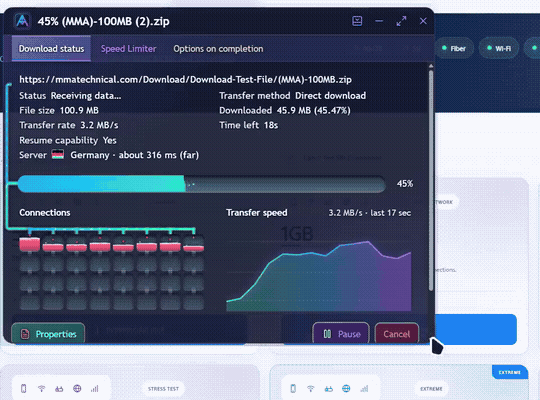
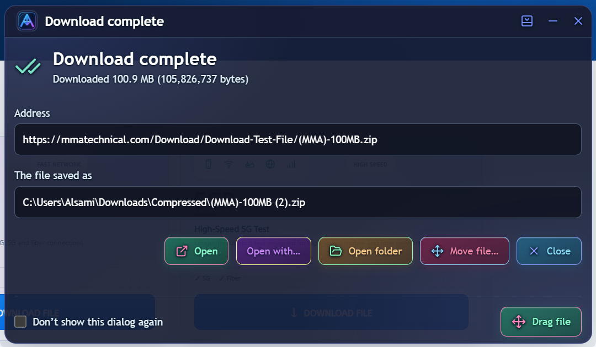

# Auralis Download Manager

[English](README.md) · [العربية](README.ar.md) · [Español](README.es.md) · [Français](README.fr.md) · [Deutsch](README.de.md) · [Português](README.pt-BR.md) · [简体中文](README.zh-CN.md)

O Auralis é um gerenciador de downloads gratuito para Windows x64, com interface inspirada em vidro, controles detalhados e extensão de navegador. É uma bifurcação independente GPL-3.0 do [Mister Download Manager](https://github.com/anefzaoui/misterdownloadmanager), não uma versão oficial.

[Baixar a versão mais recente para Windows](https://github.com/4ls4mi/Auralis-Download-Manager/releases/latest) · [Extensões de navegador](https://github.com/4ls4mi/Auralis-Download-Manager/releases/latest) · [Notas das versões](CHANGELOG.md)

## Imagens

### Gerenciador de downloads

### Download em andamento

### Informações do arquivo

### Download concluído

### Configurações de aparência

## Recursos

- Downloads com múltiplas conexões, pausa e retomada, filas, limites de velocidade e gráfico em tempo real.
- Extensão para enviar downloads e links de mídia compatíveis. Os pacotes Chromium e Firefox estão nos arquivos da versão e exigem instalação e permissões.
- Janelas separadas para download, informações, conclusão e configurações, com materiais, cores e indicadores independentes.
- Controles na bandeja, inicialização opcional com Windows e ícone separado para janelas ocultas.
- Consulta de qualidades de vídeo e áudio com yt-dlp, usando a sessão do navegador ou arquivo de cookies quando aceito pelo site.
- Notificações e atualizações no aplicativo, além de backup e restauração de preferências.
- O mecanismo de download funciona no Auralis; um pequeno assistente nativo conecta o navegador ao aplicativo.
- Adicione links HTTP, HTTPS ou FTP ou envie-os pelo navegador; a janela mostra velocidade, conexões e tempo restante. A retomada depende da origem, e a gravação em disco ou verificação pode demorar.
- Somas completas compatíveis fornecidas pelo servidor podem ser usadas. Adicione um torrent ou magnet, revise arquivos e destino e confira novamente as peças por seus hashes. Algumas junções de áudio e vídeo exigem FFmpeg.
- A exportação de tema inclui paleta, material, tipografia e indicadores, mas não os arquivos de papel de parede. Consulte o [formato de tema](docs/auralis-theme-format.md).

O backup de preferências exclui senhas, credenciais e cookies; talvez seja necessário entrar novamente. Restrições de sites e navegadores podem afetar a busca de vídeos.

## Guias e recuperação

Consulte os [guias](docs/auralis-guide-drafts/pt-BR.md), disponíveis em vários idiomas e em atualização.

Downloads comuns segmentados gravam os bytes em suas posições em um único arquivo temporário. A verificação detecta alterações em blocos com hashes salvos; o reparo exige servidor compatível e não força suporte a intervalos. É possível comparar torrent ou magnet, ou pesquisar no Internet Archive, para recuperar um download interrompido. Peças coincidentes não comprovam o restante; são necessários pares e o arquivo parcial original é preservado. A recuperação automática está em desenvolvimento.

Exporte e importe temas JSON editáveis com os indicadores. O backup de preferências ainda não inclui arquivos baixados, parciais ou histórico; o backup completo está em desenvolvimento.

## Instalação

Baixe e execute o instalador Windows x64 da [versão mais recente](https://github.com/4ls4mi/Auralis-Download-Manager/releases/latest). Instale a extensão correspondente e siga **Configurações → Integração do navegador**.

## Licença e atribuição

O Auralis é distribuído sob a [GNU GPL v3](LICENSE). É uma bifurcação do Mister Download Manager, de Ahmed Nefzaoui e colaboradores; consulte [atribuição](ATTRIBUTION.md) e o [projeto original](https://github.com/anefzaoui/misterdownloadmanager).
